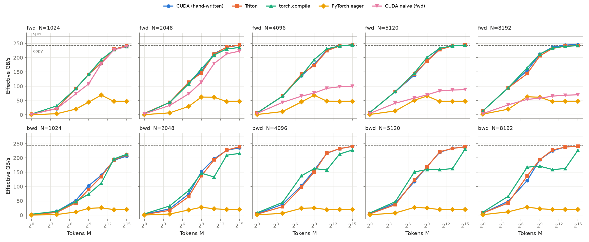
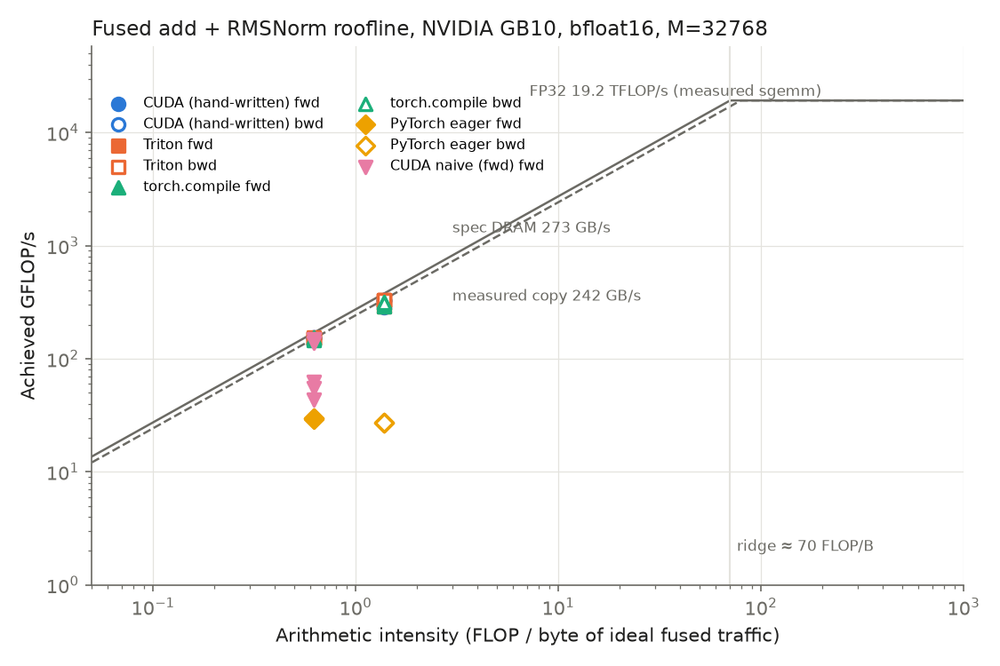

# Fused residual-add + RMSNorm: Triton vs hand-written CUDA

One op, written twice, forward and backward. The CUDA version is registered as
a PyTorch extension, and both are benchmarked against eager PyTorch and
`torch.compile` on an NVIDIA GB10 (DGX Spark).

```
s = x + residual                                 # new residual stream (returned)
y = s · rsqrt(mean(s²) + eps) · w                # normalized output (returned)
```

This is the pre-norm pattern every Llama-style decoder layer runs twice
(`h = h + attn(...)`, then `rmsnorm(h)`). It does about 5 FLOPs per element and
moves at least 8 bytes per element (bf16), so it is **memory-bound by two
orders of magnitude** (arithmetic intensity 0.6 FLOP/B vs a ridge point of
about 70 FLOP/B on GB10). The only thing that matters is how many bytes cross
the DRAM bus, and how close to peak bandwidth they cross it.

## Headline (bf16, GB10, measured)

Measured device-to-device copy bandwidth is **242 GB/s** (spec is 273 GB/s
LPDDR5x). "GB/s" below is *effective* bandwidth: the ideal fused byte count
divided by the time, the same numerator for every implementation.

| shape (M × N) | pass | eager | torch.compile | Triton | CUDA | CUDA GB/s |
|---|---|---:|---:|---:|---:|---:|
| 32768 × 4096 | fwd | 22.76 ms | 4.39 ms | 4.38 ms | 4.39 ms | 245 (101% of copy) |
| 32768 × 4096 | bwd | 54.43 ms | 4.72 ms | 4.47 ms | 4.47 ms | 240 (99%) |
| 8192 × 8192 | bwd | 27.22 ms | 3.30 ms | 2.26 ms | 2.25 ms | 238 (98%) |
| 2048 × 4096 | bwd | 3.50 ms | 0.42 ms | 0.31 ms | 0.31 ms | 216 (89%) |
| 128 × 8192 | bwd | 301 µs | **50 µs** | 62 µs | 70 µs | 121 (50%) |
| 1 × 4096 | fwd | 36.7 µs | 5.9 µs | 6.0 µs | 6.1 µs | latency-bound |

* **Forward:** all three fused versions (Triton, CUDA, Inductor) hit the
  bandwidth roof at large M (228–245 GB/s at M ≥ 8192) and are within a few
  percent of each other. That's the
  expected result. Once you're at the roof, there is nothing left to win.
  Eager is **5.2× slower**, which the byte count below predicts exactly.
* **Backward:** hand-written Triton and CUDA reach 96–100% of copy bandwidth
  and are **up to 1.47× faster than `torch.compile`** (M = 2048–8192), and
  **12× faster than eager**.
* **Where we lose:** small-M backward (M ≤ 128), where `torch.compile` is up
  to 1.4× faster, and N = 1024 at large M, where all fused versions plateau
  at 80–88% of the roof. Both are explained below.

Full tables: [results/summary.md](results/summary.md). Raw data: [results/bench.csv](results/bench.csv).
fp16 and fp32 results are in [results/float16](results/float16) and
[results/float32](results/float32); see "Other dtypes" below.




---

## Layout

```
fused_norm/
  reference.py          eager reference, torch.compile wrapper, hand-derived backward, byte/FLOP model
  triton_kernels.py     Triton fwd + bwd kernels + autograd.Function
  csrc/fused_add_rmsnorm.cu   CUDA fwd + bwd + naive baseline
  csrc/binding.cpp      pybind11 registration
  cuda_ops.py           JIT build (or prebuilt via setup.py) + autograd.Function
tests/
  test_math.py          CPU: hand-derived backward == autograd (fp64, 1e-10)
  test_correctness.py   GPU: Triton/CUDA vs fp64 gold, fwd+bwd, 3 dtypes, 8 shapes
bench/
  benchmark.py          sweep → results/bench.csv, meta.json (incl. measured peaks);
                        --dtype float16|float32 --out results/<dtype> for the other dtypes
  plot.py               roofline.png, bandwidth.png, summary.md
  bwd_grid_sweep.py     backward persistent-grid size sweep
profile/
  ncu.sh, summarize_ncu.py, run_one.py    Nsight Compute driver + metric table
  ncu_gb10_host.sh      runs ncu.sh with counter access on the GB10 box
  list_kernels.py       per-kernel device times via torch.profiler (no admin needed)
scripts/
  ptxas_report.py       registers + spills per kernel instantiation
  remote.sh             sync/run/pull against the GB10 container
  setup_cuda13_home.sh, env_gb10.sh       CUDA 13 toolchain from pip wheels (see below)
```

## Running it

On any CUDA machine with PyTorch ≥ 2.4 and Triton:

```bash
pip install -e .                    # or skip: cuda_ops.py JIT-compiles on first use
```

```bash
pytest -q tests                     # 76 GPU tests + 1 CPU math test
```

```bash
python bench/benchmark.py && python bench/plot.py --peak-gbs <your GPU's spec GB/s>
```

```bash
python scripts/ptxas_report.py --arch 90    # registers / spills, e.g. sm_90 for H100
```

```bash
bash profile/ncu.sh                 # needs GPU perf-counter permission
```

**GB10 note.** The dev container ships nvcc 12.8. That can't target sm_121
and doesn't match torch's cu130. `scripts/setup_cuda13_home.sh` builds a CUDA
13.0 toolkit dir from pip wheels (`nvidia-cuda-nvcc`, `-cccl`, `-crt`,
`-nvvm`, `-runtime`, all pinned to 13.0; nvcc 13.0 otherwise pulls in 13.5
headers, and CCCL refuses the mismatch). `scripts/env_gb10.sh` points
`CUDA_HOME` at it. torch 2.14 also requires `-std=c++20`.

## Correctness

* `test_math.py` checks the hand-derived backward against autograd in fp64 to 1e-10:
  `ds = r·g − s·r³·mean(g·s) + ds_out`, `dw = Σ_rows dy·s·r`, where `g = dy·w` and
  `r = rsqrt(mean(s²)+eps)`.
* `test_correctness.py` compares every output (`y`, `s`, `dx`, `dresidual`, `dw`)
  against a float64 gold run. Low-precision kernels can't match fp64, so the
  rule is: **error ≤ 2 × eager-PyTorch's error in the same dtype + small slack**.
  Shapes include M=1, non-power-of-2 widths (1000, 5120), widths that break
  16-byte vectorization (4100, which takes the scalar path), and M larger than
  the persistent grid. fp32, fp16 and bf16 all pass (76 tests).
* Rounding matches eager exactly: `s` is rounded to the input dtype before
  the variance, and `s·rstd` is rounded before `·w`, as in HF `LlamaRMSNorm`.

---

## The memory-bound argument (why fusion wins 5×)

Count bytes in units of one bf16 M×N tensor. The ideal fused forward reads
`x`, `r` and writes `y`, `s`: **4 units**. Eager runs 9 kernels:

| eager op | reads | writes | units |
|---|---|---|---:|
| `s = x + r` | x, r | s | 3 |
| `s.float()` | s | sf (fp32 = 2) | 3 |
| `sf.pow(2)` | sf (2) | sq (2) | 4 |
| `.mean(-1)` | sq (2) | M floats | 2 |
| `sf * rsqrt(var+eps)` | sf (2) | (2) | 4 |
| `.to(bf16)` | (2) | (1) | 3 |
| `* weight` | (1) | y (1) | 2 |
| **total** | | | **21** |

21 / 4 = **5.25×** predicted, **5.19× measured** at M=32768. Nsight Compute measures 1181 MB of
memory traffic for eager vs 268 MB fused (4.4×; see the Nsight section). Every eager
kernel already runs near bandwidth. Eager loses only because it moves 5× the
bytes. For the backward, eager launches 18 kernels and is 12× slower.

---

## Why we win or lose, by regime

GB10's CUDA-event timer ticks in about 2.05 µs steps (every small time is a
multiple: 4.1, 6.1, 8.2, …), so differences of one tick below 20 µs are noise.

### 1. Decode-sized (M ≤ 16): latency-bound, all fused versions tie

One row is 8 KB. The kernel is over before DRAM latency is even amortized, so
time is launch overhead plus one DRAM round trip, about 4–8 µs for any fused
implementation. Eager pays 9 launches (about 37 µs), so even a
"bad" fused kernel wins 6× here. In this regime **kernel count is the cost
model**, not bytes.

Backward at M=1: `torch.compile` 6 µs vs CUDA 10 µs vs Triton 14 µs. Inductor
emits fewer kernels. Ours is `bwd_kernel` plus a dependent `dw_reduce_kernel`
(2 launches, 2 ticks). Triton's wrapper is worse because `dwp.sum(0).to(dtype)`
is 2 more PyTorch kernels. The CUDA version fuses the reduction and the cast
into one kernel. **This is a real gap.** A fix is in Next steps.

### 2. Prefill-sized (M = 128–512): not enough bytes in flight

One block per row, 128 rows on 48 SMs: 2.7 waves, each a short
load → reduce → store with two `__syncthreads`. There isn't enough
independent memory traffic per SM to cover DRAM latency (Little's law), so
forward reaches 57–87% of the roof. Triton and CUDA tie with Inductor.

Backward at M=128, N=8192: `torch.compile` 50 µs vs ours 62–70 µs. Our
backward is a persistent grid that accumulates `dw` in fp32 registers and
writes one [N] partial per block. Each block costs `8·N` bytes (write + re-read),
so the grid has to stay small, and at M=128 that leaves SMs idle. The sweep
(`bench/bwd_grid_sweep.py`, N=4096, µs):

| M | G=8 | 16 | 24 | 48 | 96 | 192 | 384 | heuristic |
|---:|---:|---:|---:|---:|---:|---:|---:|---:|
| 128 | 47.1 | **38.9** | 40.9 | 44.0 | 50.1 | 55.1 | 55.2 | 40.9 |
| 512 | 133.1 | 104.4 | **99.3** | 100.2 | 103.4 | 108.4 | 120.8 | 100.7 |
| 2048 | 450.6 | 337.9 | 317.5 | **317.3** | 318.3 | 327.7 | 354.1 | 312.2 |
| 8192 | 1715.7 | 1243.1 | 1154.0 | **1145.8** | 1150.0 | 1170.3 | 1200.0 | 1143.2 |

(CUDA shown; Triton follows the same curve within 5%, as it should, since
the tradeoff belongs to the algorithm, not the language.) v1 used
`G = 4 × SMs = 192`, up to 1.4× slower. The heuristic is now
`min(M, SMs, max(16, M/8))`: about one block per SM, at least 8 rows per
block. It is shared by both implementations.

### 3. Large M (≥ 2048): at the roof, so the question is how many bytes

**Forward:** CUDA, Triton and Inductor all reach 228–245 GB/s at M ≥ 8192,
up to slightly above the copy benchmark (copy is a single stream; ours overlaps reads of two
inputs). They tie because they move the same 4 units. Nothing is left to win.

**Backward:** ours reaches 96–100% of copy at M ≥ 8192 (N ≥ 2048);
`torch.compile` drops to 65–67% at M = 2048–8192 for most N ≥ 4096 (88% at
8192×4096). `profile/list_kernels.py` shows why (M=8192, N=8192):

```
torch.compile:  1124.8 µs  triton_red_fused__to_copy_mul_sum_0                  ← dw: re-reads dy and s
                2187.1 µs  triton_red_fused__to_copy_add_div_expand_mul_pow_sum_1  ← dx
                3311.9 µs  total
CUDA:           2205.1 µs  bwd_kernel<bf16, VEC=8, ITERS=2, HAS_DSO>   ← dx and dw partials in one pass
                   2.3 µs  dw_reduce_kernel                            ← [48, N] fp32, tiny
                2207.4 µs  total
```

Inductor computes `dw = Σ_rows dy·ŝ` as a **separate column reduction** that
reads `dy` and `s` over all M a second time: 2 extra units on top of 4, a
1.5× penalty, matching the measured 1.47×. At M=32768 Inductor's heuristics
switch to a single persistent kernel with split `dw`, and it ties with us
again. The hand-written kernels win because the `dw` partials are accumulated
**in registers in the same pass** that produces `dx`.

### 4. N = 1024: everyone plateaus at 80–88%

A 2 KB row is 128 sixteen-byte vectors, so one block is 128 threads, 4 warps.
Even with 48 persistent blocks that's 4 warps per SM, which can't keep enough
loads in flight. All three fused versions plateau at 192–213 GB/s. The fix is
several rows per block (a 2D block), the standard trick for narrow rows. Not
done yet.

### 5. Non-power-of-2 N (5120): no penalty for Triton's padding

Triton rounds `BLOCK_N` up to 8192, so 37.5% of lanes are masked. Masked lanes
issue no memory traffic, and the kernel is memory-bound, so idle ALUs cost
nothing. Measured Triton vs CUDA at N=5120 is within 1%.

---

## Other dtypes: fp16 and fp32

Same sweep, same GPU ([fp16 tables](results/float16/summary.md),
[fp32 tables](results/float32/summary.md); plots alongside). Times in µs,
CUDA's speedup in parentheses:

| shape | pass | dtype | eager | torch.compile | Triton | CUDA | CUDA GB/s |
|---|---|---|---:|---:|---:|---:|---:|
| 32768×4096 | fwd | bf16 | 22761 (5.19×) | 4386 | 4381 | 4386 | 245 |
| | | fp16 | 22773 (5.19×) | 4399 | 4396 | 4389 | 245 |
| | | fp32 | 21886 (**2.49×**) | 8920 | 8911 | 8785 | 244 |
| 8192×8192 | bwd | bf16 | 27219 (12.1×) | 3301 (1.46×) | 2257 | 2255 | 238 |
| | | fp16 | 27242 (12.1×) | 3334 (1.49×) | 2252 | 2244 | 239 |
| | | fp32 | 29459 (6.6×) | 6932 (**1.55×**) | 4505 | 4469 | 240 |

* **fp16 = bf16.** Same element size, same bytes, same times to within noise.
  Nothing in the kernels depends on the 16-bit format beyond the conversion
  instructions, and those are free in a memory-bound kernel.
* **fp32 fused kernels take 2× as long at the same 240–244 GB/s.** Twice the
  bytes at the same bandwidth; the roof is the roof.
* **Eager fp32 is only 2.5× slower than fused, not 5.2×.** In fp32,
  `s.float()` and `.to(dtype)` are no-ops (no kernel, no copy), and the
  intermediates are no wider than the inputs. Counting in fp32-tensor units:
  add 3 + pow 2 + mean 1 + scale 2 + `·w` 2 = **10 units vs 4 → 2.50×
  predicted, 2.49× measured**. Eager's absolute time barely changes from bf16
  (21.9 ms vs 22.8 ms), because in bf16 it already moved fp32 intermediates.
  Fusion's payoff is largest in exactly the low-precision formats people
  actually train and serve in.
* **The backward win over `torch.compile` grows slightly in fp32** (1.55×):
  Inductor's separate dw pass re-reads `dy` and `s`, and in fp32 that re-read
  costs twice the bytes.
* The small-M and N=1024 behavior matches bf16 (see the regimes above).

---

## The CUDA kernel, walked through

`fused_norm/csrc/fused_add_rmsnorm.cu`. Each item has a measurement behind it.

### Coalesced, 128-bit vectorized loads

Thread `t` loads 16-byte vector `t`, then `t + blockDim`, and so on. A warp's
32 lanes read 512 contiguous bytes with one `LDG.E.128` per lane: every 32-byte
sector fetched is fully used, and the instruction count is 8× smaller than with
scalar bf16 loads. Packing is a `struct alignas(16) Vec<T, 8>`. The fast path
needs `N % 8 == 0` and 16-byte-aligned pointers; otherwise a `VEC=1` scalar
instantiation is used (tested with N=1000 and 4100).

The **naive baseline** (`fwd_naive_kernel`, `impl=cuda_naive`) gives each
thread a *contiguous chunk* of the row. At each step the 32 lanes then touch
addresses `chunk·2` bytes apart, which is uncoalesced. Measured at M=32768:

| N | naive GB/s | optimized GB/s | chunk per thread |
|---:|---:|---:|---:|
| 1024 | 239 | 241 | 4 elems (8 B), so lanes still share sectors |
| 2048 | 222 | 245 | 16 B |
| 4096 | 100 | 245 | 32 B, one sector per lane: **2.4× slower** |
| 8192 | 70 | 245 | 64 B, **3.5× slower** |

Nsight Compute confirms it at N=4096: 32 sectors per load request vs 16, and
10.7× the load instructions, for the same total bytes. The degradation tracks the chunk size exactly: once each lane's stride reaches
32 B, every lane needs its own sector, and L1 thrashes between passes.

### Register row cache

Each row is read from DRAM once. `s` is kept in registers
(`float sreg[ITERS][VEC]`) between the sum-of-squares reduction and the
normalize pass. The naive kernel re-reads `s` from global memory instead.

### Warp-shuffle reductions

`__shfl_xor_sync` butterfly inside each warp (5 steps, no shared memory), one
`float` per warp into a 32-slot shared array, then one more warp shuffle. That
is two `__syncthreads` per reduction, against `log2(blockDim) ≈ 9` for the
naive shared-memory tree. **Shared memory is used only for that cross-warp
step.** The row itself lives in registers, which are faster and don't limit
occupancy for these sizes. (Shared memory would only be needed for rows too
wide to fit in registers, N > 32K.)

### Backward: one pass, persistent grid, no atomics

Each block loops over rows `blockIdx.x, +G, …`. It loads `dy`, `s`, `w`,
block-reduces `Σ g·s`, writes `dx`, and accumulates `dy·s·rstd` into
fp32 registers. At the end it writes one [N] partial, and a small coalesced
`dw_reduce_kernel` sums the [G, N] partials and casts to the weight dtype. No
atomics, deterministic, and the grid size is tuned as shown above.

### The register-spill bug (found with `ptxas -v`)

v1 had a fixed 32-element-per-thread register cache under
`__launch_bounds__(1024)`, which caps a thread at 64 registers. The backward
keeps 3–4 such arrays live. `scripts/ptxas_report.py` on v1:

```
bwd_kernel+dso  bf16 VEC=8   regs=64  spill_st/ld=496/492 B   ← every row through local memory
fwd_kernel      bf16 VEC=1   regs=64  spill_st/ld=40/76 B
```

In a memory-bound kernel, spills are extra memory traffic. v1's backward was
**2.2× slower than Triton** at M=128, N=5120 (142 µs vs 64 µs). The fix:

1. Make `ITERS` (vectors per thread) a template parameter chosen at launch
   from N, so register use scales with the actual row. For N=4096 that is
   8 elements per thread, not 32.
2. Give the backward `__launch_bounds__(512)` (up to 128 registers).
3. Stop pinning `w` in registers (it's N elements and stays L1/L2-resident).

After the fix ([results/ptxas_v2.txt](results/ptxas_v2.txt)) no instantiation
reachable at N ≤ 16384 spills. Only the 64-element fallback for
16K < N ≤ 32K does. Triton did this automatically: its compiler sizes
registers per `BLOCK_N` and `num_warps`. **This is the clearest
Triton-vs-CUDA difference in the project.**

### A benchmark bug found with the profiler

The first backward sweep plateaued at 67% of the roof for *every* fused
implementation. `torch.profiler` showed a 540 µs `Memcpy DtoD` next to a
1130 µs kernel. Both `x` and `residual` were leaf tensors receiving the same
`dx`, so autograd's `AccumulateGrad` copied it for the second leaf: an extra
read and write (4 + 2 units, and 4/6 = 67%). Mid-network, both gradients flow
on without that copy, so the benchmark now only makes `x` a leaf. It's worth
knowing that the roof you measure can be set by the harness.

---

## Triton vs CUDA on the same op

| | Triton | CUDA |
|---|---|---|
| forward speed | = CUDA (≤1% at M ≥ 8192; up to 7% apart at mid sizes, either direction) | = Triton |
| backward speed | = CUDA at M ≥ 512; slower at tiny M (2 extra PyTorch kernels for `dw.sum().to()`) | 1 fused reduce+cast kernel |
| lines of kernel code | ~60 | ~300 + dispatch |
| coalescing / vectorization | automatic (`tl.load` on a contiguous `arange`) | manual `Vec<T,8>`, alignment checks, scalar fallback |
| registers / spills | compiler sizes per `BLOCK_N`; no spill bug possible to write | hand-chosen, and v1 spilled 500 B/thread |
| reductions | `tl.sum`, lowered to shuffles | hand-written warp + block reduction |
| non-pow2 N | pads to the next power of 2 (free when memory-bound) | exact |
| control | can't choose `__launch_bounds__`, smem layout, or fuse the cast into the `dw` reduce kernel without another Triton kernel | everything |

For a memory-bound row-wise op, **Triton matches CUDA once both implement the
same algorithm.** The speed is set by bytes moved, and both move the same
bytes. CUDA's advantage was control: fusing the last cast, picking launch
bounds, and seeing SASS-level spills. It also made it possible to write a
2.2× regression that Triton wouldn't have allowed.

---

## Nsight Compute (measured on GB10, M=8192, N=4096, bf16)

`profile/ncu.sh` profiles the naive, CUDA and Triton forward, the CUDA and
Triton backward, and the eager forward. `profile/summarize_ncu.py` turns the
CSVs into [results/ncu/summary.md](results/ncu/summary.md). The `--set full`
reports (`results/ncu/*.ncu-rep`, left on the GB10 box because of their size)
open in the Nsight Compute GUI. Built with `-lineinfo`, so the Source page
shows SASS next to `.cu` lines.

**GB10 specifics.** The driver restricts counters to admins
(`RmProfilingAdminOnly=1`), and the container's ncu 2025.1.1 can't initialize
on GB10. `profile/ncu_gb10_host.sh` runs the profile in a throwaway `--rm`
container with `--cap-add SYS_ADMIN` and the host's ncu 2025.3.1. GB10's
unified LPDDR5x has **no `dram__*` counters**, so memory traffic is measured
as L2-miss sectors × 32 B (`lts__t_sectors_op_{read,write}_lookup_miss`).

| kernel | time µs | memory MB | GB/s | sectors / ld request | global ld instr | spill bytes | regs | occupancy |
|---|---:|---:|---:|---:|---:|---:|---:|---:|
| ideal (4 units) | | **268.4** | | | | | | |
| CUDA `fwd_kernel` | 1146 | 268.5 | 234 | 16.0 | 393 K | 0 | 27 | 92% |
| Triton `_fwd_kernel` | 1143 | 268.7 | 235 | 16.0 | 393 K | 0 | 29 | 93% |
| CUDA `fwd_naive_kernel` | 3221 | 268.7 | 83 | **32.0** | **4.19 M** | 0 | 33 | 98% |
| CUDA `bwd_kernel` | 1163 | 269.3 | 232 | 13.0 | 655 K | 0 | 50 | 33% |
| CUDA `dw_reduce_kernel` | 12 | 0.8 | | | | 0 | 40 | |
| Triton `_bwd_kernel` | 1143 | 269.3 | 236 | 12.3 | 525 K | 0 | 64 | 34% |
| Triton `dwp.sum(0)` + `.to()` | 18 + 10 | 0.9 | | | | | | |
| eager fwd, 8 kernels | 5525 | **1181** | | 2.0–16 | | | | |

What this shows:

* **The fused kernels move exactly the ideal bytes.** Forward 268.5 MB and
  backward 269.3 MB, against 268.4 MB for 4 units. No hidden re-reads, no
  spill traffic, and the dw partials are a rounding error (0.8 MB). They run
  at 232–236 GB/s, i.e. the bandwidth roof.
* **CUDA and Triton compile to the same memory behavior.** Same bytes, same
  16 sectors per request (128-bit loads), same instruction count in the
  forward. Triton's backward issues fewer loads (525 K vs 655 K) because it
  keeps `w` in registers across rows: 4 loads per warp per row
  (`dy`, `s`, `ds_out`, `rstd`) × 16 warps × 8192 rows = 524 K, plus `w` once.
  Ours reloads `w` every row (5 × 16 × 8192 = 655 K), a deliberate trade made
  to fix the register spills. It costs no DRAM bytes (`w` hits in L1), and
  the two run at the same speed.
* **Uncoalesced access costs L1 throughput, not DRAM bytes.** The naive kernel
  moves the *same* 268.7 MB, because L1/L2 eventually merge the scattered
  accesses. But it needs 32 sectors per request instead of 16 and
  10.7× the load instructions (scalar 2-byte loads vs `LDG.128`). It
  saturates the memory pipeline (83% of peak memory-subsystem throughput vs
  14%) and takes 2.8× longer. That's why you look at sectors/request, not just bytes.
* **Eager moves 1181 MB = 4.4× ideal** in 8 kernels (the per-op table above
  over-counts slightly: one intermediate partially hits in the 24 MB L2).
  The rest of the 5.2× time gap comes from two non-vectorized
  `elementwise_kernel`s at 2.0–2.5 sectors/request running at 166–212 GB/s.
* **Occupancy isn't the limit.** The backward runs at 33% occupancy (48
  persistent blocks × 16 warps) and still hits 232–236 GB/s. With 16-byte
  loads, each warp keeps enough bytes in flight.
* The forward profile uses `M=8192` (one block per row, 8192 blocks); the
  backward uses the heuristic grid (48 blocks = 1 per SM).

## Next steps

* **Small-M backward:** for M ≤ ~256, use one kernel that does
  `atomicAdd` of the fp32 partials (or a last-block-done reduction) to remove
  the second launch and close the gap to Inductor.
* **N ≤ 1024:** several rows per block to raise warps per SM.
* **RoPE fusion:** fold rotary embedding of the q/k projections into the
  same row pass. Different access pattern (pairs of elements), same
  bandwidth argument.
* Profile the losing regimes (M ≤ 128 backward, N = 1024) with ncu to confirm
  the latency / bytes-in-flight explanation; only M=8192 was profiled so far.
